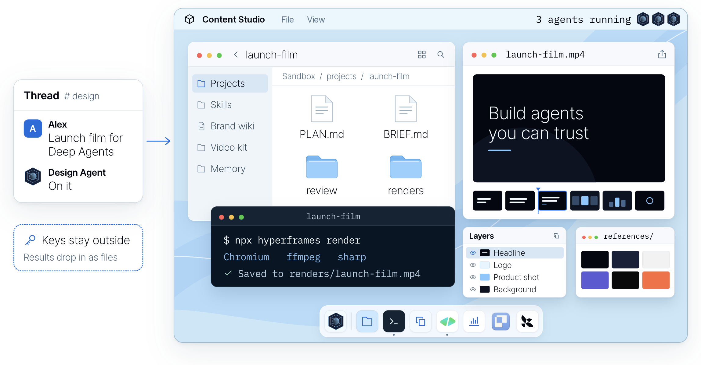

<div align="center">
  <p>
    <a href="https://www.langchain.com/?utm_source=github&utm_medium=readme&utm_campaign=design-agent#gh-light-mode-only"></a><a href="https://www.langchain.com/?utm_source=github&utm_medium=readme&utm_campaign=design-agent#gh-dark-mode-only"></a>
  </p>
  <picture>
    <source media="(prefers-color-scheme: dark)" srcset="https://github.com/langchain-ai/design-agent/raw/main/docs/assets/readme/header-dark.png">
    
  </picture>
  <h1>Content Studio：Slack で動くオープンソースのデザインエージェント</h1>
  <p>
    <a href="LICENSE#gh-light-mode-only"></a><a href="LICENSE#gh-dark-mode-only"></a>
    <a href="https://www.python.org#gh-light-mode-only"></a><a href="https://www.python.org#gh-dark-mode-only"></a>
    <a href="https://github.com/langchain-ai/deepagents#gh-light-mode-only"></a><a href="https://github.com/langchain-ai/deepagents#gh-dark-mode-only"></a>
    <a href="https://docs.langchain.com/langsmith/python/managed-deep-agents-overview?utm_source=github&utm_medium=readme&utm_campaign=design-agent#gh-light-mode-only"></a><a href="https://docs.langchain.com/langsmith/python/managed-deep-agents-overview?utm_source=github&utm_medium=readme&utm_campaign=design-agent#gh-dark-mode-only"></a>
  </p>
  <p>
    <b><a href="#quickstart">Content Studio をチームに導入する →</a></b> ·
    <a href="#try-it-locally">ローカルで試す（キー不要）</a> ·
    <a href="https://www.langchain.com/blog/design-agent?utm_source=github&utm_medium=readme&utm_campaign=design-agent">構築の裏側</a> ·
    <a href="docs/README.md">ドキュメント</a>
  </p>
  <p>
    <a href="README.md">English</a> · <a href="README.zh-CN.md">简体中文</a> · <b>日本語</b>
    <br><sub>この翻訳は英語版 README をもとにしています。英語版より更新が遅れることがあります。</sub>
  </p>
</div>

**LangChain が社内で運用しているデザインエージェント Content Studio を、オープンソースで公開しました。** ブランドを追加して Managed Deep Agents でチームの Slack にデプロイすれば、Slack で動くデザイン AI になります。誰でもデザイナーに頼む感覚で依頼でき、手元の素材を添付すれば、広告のリサイズからローンチ映像まで、ブランドに沿った完成ファイルが返ってきます。

8 月以降、社内向けに 3,000 点以上のアセットを納品し、その作品を使った X の投稿は約 450 万回表示されました。依頼の 4 件に 3 件はマーケティング以外のチームから来ています。各部分の詳細は[構築の裏側](https://www.langchain.com/blog/design-agent?utm_source=github&utm_medium=readme&utm_campaign=design-agent)で解説しています。

## まずは作例を見てください

Content Studio に自分のローンチ映像を作らせてみたら、『ロッキー』に全振りしてきました。

https://github.com/user-attachments/assets/ee5b98e0-7ec6-4b24-ada6-1f27087947a3

<p align="center"><sub>1 ビットのひよこが、47 秒でチャンピオンに。</sub></p>

## デザインエージェントの仕組み

Content Studio は [Deep Agents](https://github.com/langchain-ai/deepagents) で構築したエージェントで、[Managed Deep Agents](https://docs.langchain.com/langsmith/python/managed-deep-agents-overview?utm_source=github&utm_medium=readme&utm_campaign=design-agent) 上で動いています。Managed Deep Agents がインフラ（Slack、サンドボックス、メモリ、スケジュール、トレーシング）を担い、このリポジトリは、その上に載るデザインエージェント本体です。クリエイティブの判断はモデルが、レンダリング・チェック・納品はコードが担当します。

<p align="center">
  <picture>
    <source media="(prefers-color-scheme: dark)" srcset="https://github.com/langchain-ai/design-agent/raw/main/docs/assets/readme/architecture-dark.png">
    
  </picture>
</p>

<p align="center"><sub>LangChain での運用構成です。お使いの環境は、自分で有効にした連携だけで始まります（<a href="docs/integrations.md">インテグレーション</a>）。</sub></p>

- **Slack**：スレッドで、依頼内容とファイルを添えてメンションします。MDA の Slack アプリがメッセージと添付ファイルをエージェントに渡し、完成したファイルは同じスレッドに返ってきます。作業中は 1 つのメッセージがステップごとに更新され、フッターには実行中の処理とここまでのコストが表示されます。途中で追加した内容も進行中の作業に反映されます。
- **スレッドごとに専用のコンピューター**： 各スレッドには専用の LangSmith サンドボックスが用意されます。Chrome、FFmpeg、[HyperFrames](https://hyperframes.heygen.com)、D2、自社フォントを備えた Linux マシンで、バージョンを固定した単一のレシピ（[`sandbox/setup.sh`](sandbox/)）から構築されます。作るものはすべてプロジェクトフォルダー内のコード（スライドは HTML、映像はアニメーションのタイムライン）なので、修正はコードを編集して再レンダリングするだけで済み、ゼロから作り直す必要はありません。API キーがサンドボックスに入ることはありません。
- **スキルとデザイン wiki**：常に読み込まれるプロンプトはコンパクトに抑えています。依頼のたびに、まずルーター役のスキルを読み、広告のリサイズからローンチ映像まで、35 個の[スキル](skills/)から依頼に合ったワークフローを選びます。wiki にはデザインのノウハウ（タイポグラフィ、色、レイアウト、チャート）が、ブランドパックにはブランド固有の情報が入っています。スキルは必要なときだけ読み込まれ、MDA が Context Hub から提供します。
- **ツール連携**：映像は HyperFrames で作ります。HyperFrames は、映像をタイムライン上の Web ページとして扱います。[Paper](https://paper.design) は共有キャンバスで、絵コンテやレイアウトを直接編集できます。画像・音声・音楽のモデルはサンドボックスの外でツールとして動きます。Notion、Linear、GitHub、Figma などの MCP サーバーは MDA 経由でつながり、各自が自分のアカウントでサインインして使います。
- **非同期サブエージェント**： 大きな作業では、メインエージェントが計画を立てて作業を分割し、同じサンドボックスとファイルを使うサブエージェントをバックグラウンドで起動します。サブエージェントが完了・失敗・停滞すると MDA がメインエージェントを起こすので、メインエージェントは待ちっぱなしにならず、その間もやり取りを続けられます。映像は絵コンテ、ビデオコンテ、本制作の順に進み、組み立て前にすべてのパートがレビューを通過するよう、コードで担保しています。
- **メモリ**：「LinkedIn ではオレンジを使わない」のようなルールは、一度伝えればそのターンのうちに保存されます。MDA はファイルによる 2 層のメモリを提供します。全員で共有するチームメモリと、各自の個人メモリです。各層のインデックスは毎回の実行で読み込まれます。
- **使うほど良くなる**： 作業が終わると、`learn_from_job` が、うまくいった点をそのとき使ったスキルにメモとして残します。以降の作業はそのメモを読んで評価し、役に立たないと分かったメモは削除されます。

### 自分の仕組みを、自分で解説

自分のハーネスを、ドット絵のオウムが主演する自然ドキュメンタリー仕立てで解説させました。コンピューター、ツール、そして作業の裏にあるコンテキストを順に案内します。

https://github.com/user-attachments/assets/65eac8e4-0fac-4a5a-9cca-02e26a0a8baa

<p align="center"><sub>絵コンテから制作、ナレーションまで、すべてエージェントが 1 つの Slack スレッドでこなしました。</sub></p>

<details>
<summary>この映像を作ったプロンプト</summary>

エージェントは、この依頼と数回のフィードバックから作りました：

> Make a short explainer of how you create videos in code, end to end, for our blog post on the
> media harness we built on Deep Agents. Narrate it like a David Attenborough nature documentary,
> starring the pixel parrot from our promo, with your subagents as its flock. Keep it technical
> enough for an engineer, in real terms: skills, wiki, tools, apps. Storyboard it before you build,
> and end on "Built on Managed Deep Agents".

</details>

[アーキテクチャ](docs/architecture/README.md)を読むか、さっそく手を入れてみましょう：[instructions.md](instructions.md) · [skills/](skills/) · [カスタマイズ](docs/customization.md) · [評価（Evals）](docs/evals.md) · [運用](OPERATIONS.md) · [コントリビュート](CONTRIBUTING.md)。

## AI っぽく見えない理由

<p align="center">
  <picture>
    <source media="(prefers-color-scheme: dark)" srcset="https://github.com/langchain-ai/design-agent/raw/main/docs/assets/readme/same-prompt-dark.png">
    
  </picture>
</p>

<p align="center"><sub>同じプロンプトを、ブランド用のスキルを入れたローカルのコーディングエージェントと、Content Studio に渡した結果。</sub></p>

- **仕上がりを自分の目で確かめる**：レンダリングしたら、何かを投稿する前に必ず画像を見て確認します。
- **ブランドはコードで定義**：レイアウトに使えるのは、自社ブランドのデザイントークン（色、フォント、余白）だけです。
- **機械で測れるものは、機械がチェック**： 色、フォント、コントラスト、サイズ、チャートの数値は、レンダリングのたびにコードで検証します。センスの判断はデザイナーに任せます。

<p align="center">
  
</p>

<a name="quickstart"></a>

## クイックスタート

| 自前で構築する場合 | ここから始める場合 |
| --- | --- |
| ハーネス、サンドボックス、スキル、Slack の UX に数か月 | フォークしてブランドを追加し、コマンド 1 つでデプロイ |
| きれいだけど、ほかと見分けがつかない量産型の仕上がり | 自社ブランドに沿った仕上がりを、レンダリングのたびにチェック |
| デザイン依頼がキューで順番待ち | 誰でも Slack で依頼でき、グラフィックなら数分、長めのスライド資料も一晩で |
| どのチームも同じミスを直している | スキルを一度直せば、以降のすべてのアセットに反映 |

動画で見たい方は、[5 分のウォークスルー](https://www.youtube.com/watch?v=emId9_O2sU8)（英語）をどうぞ。3 ステップでデプロイし、Slack でローンチカードとローンチ映像を作るところまで紹介しています。

このリポジトリは [Managed Deep Agents](https://docs.langchain.com/langsmith/python/managed-deep-agents-overview?utm_source=github&utm_medium=readme&utm_campaign=design-agent) プロジェクトなので、そのまま LangSmith ワークスペースにデプロイできます。必要なのは LangSmith アカウント（Managed Deep Agents は LangSmith Cloud でパブリックベータ提供中）とモデルの API キーです：

```bash
curl -fsSL https://raw.githubusercontent.com/langchain-ai/design-agent/main/install.sh | bash
cd design-agent
uv run design-agent config set LANGSMITH_API_KEY ANTHROPIC_API_KEY   # type each key; it stays hidden
uv run mda deploy --agent-server-type dedicated   # the agent, its computer and its Slack app
```

インストーラーは、[uv](https://docs.astral.sh/uv/) が入っていなければ導入し、リポジトリをクローンして依存関係をインストールします。`git clone` と `uv sync` でも同じことができます。

`config set` はキーを 1 つずつ尋ね、入力は画面に表示されません。初回の `mda deploy` は、各スレッドが作業する Linux マシンを `sandbox/setup.sh` から構築し（10〜15 分）、以降はスレッドごとにそのコピーを使います。作り直すのはレシピを変えたときだけです。`dedicated` の Agent Server はリクエストの合間も動き続けるので、バックグラウンドのヘルパーが止まりません（指定しないと、ゼロまでスケールダウンする serverless になります）。

**LangSmith Gateway を使う場合**：プロバイダーの API キーは不要です。`uv run design-agent config set DESIGN_AGENT_MODEL=langsmith:anthropic/claude-opus-5-5` を実行してください。エージェントは `LANGSMITH_GATEWAY_API_KEY`（なければ `LANGSMITH_API_KEY`）を使い、`OPENAI_API_KEY` がない場合は画像生成も Gateway 経由になります。その他の OpenAI 互換エンドポイントには、`DESIGN_AGENT_MODEL_BASE_URL` と `DESIGN_AGENT_MODEL_API_KEY_ENV` を設定してください（[モデル](docs/models.md)）。

初回のデプロイは Slack アプリをセットアップするので、自分のターミナルで、個人用アクセストークン（`lsv2_pt_…`。サービスキーでは Slack を設定できません）を使って実行してください。`mda deploy` が表示する Slack のリンクからワークスペースでアプリを承認すると（管理者の承認が必要な場合もあります）、Slack の確認後にデプロイが自動で続きます。その後エージェントから DM が届くので、返信するか、チャンネルに `/invite` してメンションしてください。LangChain でもこの形で運用しています。変更を試すときは `uv run mda deploy --name design-agent-test` でデプロイした別のコピーを使いましょう。エージェントモードが有効なワークスペースでは、`uv run mda deploy --agent-environment production`（または `staging`、`development`）でエージェントの指定した環境にデプロイできます。トレースは環境ごとに分かれるので、LangSmith でエージェントを開いて環境を選んでください。`uv run mda dev` のトレースは Local 環境に記録されます。キー、デプロイされる内容、動作確認については [MDA でデプロイする](docs/deploy-mda.md)を参照してください。

**コーディングエージェントに任せることもできます。** Claude Code、Codex、Cursor でリポジトリを開き、やりたいことを伝えてください。[AGENTS.md](AGENTS.md) が各依頼を、手順をまとめた[スキル](.agents/skills/)に振り分けます：

| 伝えること | エージェントがすること |
| --- | --- |
| 「うちの Slack にデプロイして」 | サンドボックスをパブリッシュし、デプロイ内容を確認して、OK が出たらデプロイ |
| 「Web サイトとブランドガイドからブランドパックを作って」 | パックを下書きして検証し、レビューを依頼 |
| 「週刊ニュースレターのヘッダーを作れるようにして」 | そのためのスキルを追加し、実際の依頼で試す |
| 「その変更で良くなった？」 | 変更前後で評価を実行し、数値を見せる |

<a name="try-it-locally"></a>

## ローカルで試す

デモでは、台本どおりに応答するモデルを使い、API キーなしで本物のエージェント、サンドボックス、チェックを動かします。**Docker** が必要で、`workspace/out/demo/` に 3 サイズのローンチ告知画像と 4 秒のティザーが出力されます：

```bash
uv run design-agent sandbox build
uv run design-agent demo
```

`.env` にモデルの API キーを設定すれば、実際の依頼を試せます。ファイルは `workspace/out/<thread>/` に保存され、出力の最後の行に、その実行にかかったコストが表示されます：

```bash
uv run design-agent ask "A LinkedIn card announcing our design review service, 1200x627."
```

## 自社ブランド向けにカスタマイズする

このリポジトリには 2 種類のスキルがあります。[`.agents/skills/`](.agents/skills/) のスキルは、セットアップ、ブランド設定、デプロイ、リポジトリの改修のために、お使いのコーディングエージェントが使うものです。[`skills/`](skills/) のスキルは、Content Studio が作業中に読むものです。両方について [カスタマイズ](docs/customization.md)で説明しています。

| やりたいこと | 追加するもの | ガイド |
| --- | --- | --- |
| 自社ブランド | `workspace/brand/` を追加して再デプロイ（追加するまでは中立的なサンプルブランドで動作） | [brand-onboarding スキル](.agents/skills/brand-onboarding/SKILL.md) |
| 画像生成 | `OPENAI_API_KEY`、`GOOGLE_API_KEY`、または LangSmith Gateway | [モデル](docs/models.md) |
| 音声、音楽、効果音 | `ELEVENLABS_API_KEY` | [sound スキル](skills/sound/SKILL.md) |
| Paper キャンバス | Paper Desktop なら `PAPER_MODE=local`、デプロイ環境では `bridged` | [Paper](docs/partners/paper.md) |
| Web 検索、社内ドキュメント、その他のツール | `config/mcp.toml` の MCP サーバー | [カスタマイズ](docs/customization.md) |

準備ができたら、デザイナーに頼む感覚で Slack から依頼してみましょう：

- 「新機能のローンチ告知画像を、LinkedIn、X、Instagram の各サイズで」
- 「ローンチ用に『ロッキー』風のプロモ映像を、音楽と効果音付きで」
- 「この CSV から週ごとの新規登録数のグラフを」（ファイルを添付）
- 「この動画の YouTube サムネイルを」
- 「このウェビナーのクリップに字幕を付けて」（クリップを添付）

このページの作例がすべて LangChain のブランドなのは、私たち自身がそのブランドで運用しているからです。ライセンス契約したフォントは、Git の管理対象外である `private-fonts/` に置きます。

## よくある質問

**費用は？** コードは無料です（Apache 2.0）。モデルの利用料はモデルプロバイダーに支払います。LangChain では 1 件あたりのモデル費用の中央値は約 50 セントで、長尺の映像やスライド資料はそれ以上かかります。Managed Deep Agents の [ホスティングは有料](https://www.langchain.com/pricing?utm_source=github&utm_medium=readme&utm_campaign=design-agent)です。エージェント、サンドボックス、Slack アプリ、スケジュールの実行を引き受けてくれます。どれも本来なら自前で構築・運用する必要があるものです。

**自社ブランドで作れますか？** はい。ブランドパックを追加すれば、すべてのファイルがそれに従います。[brand-onboarding スキル](.agents/skills/brand-onboarding/SKILL.md)が、ブランドガイド、Web サイト、ファイル、Paper ファイルから一緒にパックを作ります。

**何から始めればいいですか？** チームが毎週頼んでいるグラフィックから始めましょう。メンバーが Slack でエージェントに依頼し、レビューして修正を頼める流れができたら、次の仕事を教えていきましょう。

**Slack は必須ですか？** いいえ。デプロイしたエージェントの API を呼ぶ、LangSmith Studio で開く、ターミナル（`design-agent ask`）を使う、といった方法もあります。Managed Deep Agents では、バックグラウンドで動く長い作業（映像、複数案の並行制作）は Slack で報告されます。API 経由では、1 ターンで終わる依頼にとどめてください。

**キーは安全ですか？** サンドボックスは認証情報を一切持たず、デフォルトではネットワークにもアクセスできません。取得、生成、納品はホスト側のツールが行い、結果をファイルとして渡します。

**どのモデルに対応していますか？** デフォルトは Claude Opus 5.5 です。OpenAI や Google のモデル、任意の OpenAI 互換エンドポイント、LangSmith Gateway も使えます。[モデル](docs/models.md)を参照してください。

**自社サーバーで動かせますか？** はい。ライセンスは Apache 2.0 で、[セルフホスティング](docs/self-hosting.md)の手順なら Docker、HTTP API、自前の Slack アプリで同じエージェントを動かせます。

**なぜ名前が 2 つあるのですか？** Content Studio は LangChain 社内での呼び名で、`DESIGN_AGENT_SLACK_NAME` を設定しない限り Slack アプリの名前にもなります。リポジトリ、パッケージ、コマンドの名前は `design-agent` です。

**デザイナーの代わりになりますか？** いいえ。定型的な依頼を引き受けることで、デザイナーは自分にしかできない仕事に時間を使えます。そしてデザイナーの判断は、スキルとチェックの中に生き続けます。

**自社版を作ろう。** フォークして、ブランドトークン、フォント、スキルを追加し、チームの Slack にデプロイしましょう。手順は[クイックスタート](#quickstart)へ。役に立ったら、スターを付けていただけると他のチームが見つけやすくなります。

## 使用技術

<p>
  <a href="https://github.com/langchain-ai/deepagents"> <b>Deep Agents</b></a>
  &nbsp;&nbsp;
  <a href="https://docs.langchain.com/langsmith/python/managed-deep-agents-overview?utm_source=github&utm_medium=readme&utm_campaign=design-agent"> <b>Managed Deep Agents</b></a>
  &nbsp;&nbsp;
  <a href="https://hyperframes.heygen.com"> <b>HyperFrames</b></a>
  &nbsp;&nbsp;
  <a href="https://paper.design"> <b>Paper</b></a>
</p>

その他：[LangSmith](https://smith.langchain.com/?utm_source=github&utm_medium=readme&utm_campaign=design-agent) · [Chrome Headless Shell](https://developer.chrome.com/blog/chrome-headless-shell) · [FFmpeg](https://ffmpeg.org) · [D2](https://d2lang.com) · [Apache ECharts](https://echarts.apache.org) · [sharp](https://sharp.pixelplumbing.com)。ロゴの権利は各所有者に帰属します。HyperFrames と Paper は、このプロジェクトの土台になっているパートナープロジェクトです。

---

[Apache 2.0](LICENSE) · [権利表記](NOTICE.md) · [変更履歴](CHANGELOG.md) · [セキュリティ](SECURITY.md) · [行動規範](CODE_OF_CONDUCT.md)
