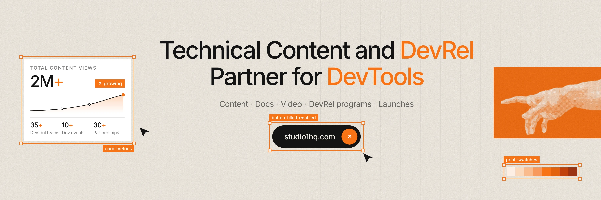

<div align="center">



<br />
<br />

# Studio1

### Technical Content and DevRel Partner for DevTools

We help SaaS and devtool teams publish content, docs, and DevRel programs<br />that build search visibility and trust.

<br />

[](https://studio1hq.com)
[](https://cal.com/studio1/collab)
[](mailto:contact@studio1hq.com)
[](https://x.com/Studio1HQ)
[](https://www.linkedin.com/company/studio1hq/)

[Case studies](https://studio1hq.com/case-studies) &nbsp;·&nbsp; [Blog](https://studio1hq.com/blog) &nbsp;·&nbsp; [About us](https://studio1hq.com/about-us) &nbsp;·&nbsp; [Careers](https://studio1hq.com/careers)

</div>

<br />

## About

Studio1 is a technical content and developer growth partner for SaaS and devtool teams. We produce tutorials, docs, videos, launches, and developer programs that drive adoption.

We help tech companies grow developer communities and boost engagement through DevRel and technical content that resonates, *one blog, video, and initiative at a time.*

<p align="center">
  <code>Developer-Centric</code>&nbsp;
  <code>Technical Expertise</code>&nbsp;
  <code>Community-Driven</code>&nbsp;
  <code>Content Focused</code>&nbsp;
  <code>End-to-End Solutions</code>
</p>

<br />

<div align="center">

| **35+** | **2M+** | **10+** | **30+** |
| :---: | :---: | :---: | :---: |
| Devtool and SaaS teams | Total content views | High-impact developer events | Successful partnerships |

</div>

<br />

## Services

| Service | What it includes |
| :--- | :--- |
| **[Technical Content Marketing](https://studio1hq.com/technical-content-marketing)** | **Technical Content Writing:** developer tutorials, guides, and documentation that build trust, rank in search, and drive product adoption. |
| **[Developer Relations & Growth](https://studio1hq.com/developer-relations-growth-campaigns)** | **Developer Advocacy:** end-to-end DevRel programs that grow communities around your product, from strategy and content to events.<br />**Organic Growth Campaign:** multi-channel campaigns that create buzz, drive adoption, and establish your product in developer communities.<br />**Product Launch Support:** strategy, content, and community activation to maximize launch visibility and convert interest into users.<br />**Influencer Management:** find relevant creators, run campaigns, and grow authentic visibility with developer-focused audiences. |
| **[Developer Video Production](https://studio1hq.com/developer-video-production)** | **Developer Video Production:** product demos, how-tos, and integration videos made for AI and DevTool teams who need developers to get it.<br />**Content Creation:** content ideas, technical angles, social posts, and distribution assets that help developer brands stay active across channels. |
| **[Documentation & DX Audits](https://studio1hq.com/developer-documentation-dx-audit)** | **Documentation & DX Audits:** docs audit, documentation, and DX improvements: onboarding reviews, shippable guides, and a clearer path to first success. |

<br />

## Campaigns we did

<table>
  <tr>
    <td width="22%"><a href="https://studio1hq.com/case-studies/nebius"><strong>Nebius</strong></a></td>
    <td>300+ deliverables, 29 framework integrations, an open-source library with 16K+ stars, and launch support across every major Token Factory moment.</td>
  </tr>
  <tr>
    <td><a href="https://studio1hq.com/case-studies/jozu"><strong>Jozu</strong></a></td>
    <td>Developer advocacy, KitOps community support, event representation, blogs, technical talks, and ecosystem collaboration for Jozu and its open-source ecosystem.</td>
  </tr>
  <tr>
    <td><a href="https://studio1hq.com/case-studies/memori"><strong>Memori</strong></a></td>
    <td>Community-led launch support, hands-on demo agents, and developer feedback helped an early OSS project grow to 12,000+ GitHub stars.</td>
  </tr>
  <tr>
    <td><a href="https://studio1hq.com/case-studies/brightdata"><strong>Bright Data</strong></a></td>
    <td>50+ live posts, first-place Google results on category comparisons, docs architecture for AI engineers, and SEO review across blog and partner content.</td>
  </tr>
  <tr>
    <td><a href="https://studio1hq.com/case-studies/corsair"><strong>Corsair</strong></a></td>
    <td>Onboarding audits, example projects, community events, and posts that grew an early open-source repo from about 300 to 2,000 GitHub stars.</td>
  </tr>
</table>

<p align="right"><a href="https://studio1hq.com/case-studies">View all case studies →</a></p>

## Trusted by

<p align="center">
  Nebius &nbsp;·&nbsp; LiteLLM &nbsp;·&nbsp; Weaviate &nbsp;·&nbsp; Bright Data &nbsp;·&nbsp; CodeRabbit &nbsp;·&nbsp; Tensorlake &nbsp;·&nbsp; Eachlabs<br />
  Velt &nbsp;·&nbsp; VMware &nbsp;·&nbsp; Maxim AI &nbsp;·&nbsp; Memori &nbsp;·&nbsp; Kombai &nbsp;·&nbsp; Ittybit &nbsp;·&nbsp; ScrapeGraph<br />
  Entelligence &nbsp;·&nbsp; Unsiloed &nbsp;·&nbsp; Interact AI &nbsp;·&nbsp; CopilotKit &nbsp;·&nbsp; SearchApi &nbsp;·&nbsp; BrowserAct
</p>

<br />

## Why teams work with us

| | |
| :--- | :--- |
| **Leaner than hiring in-house** | **No lock-in** |
| **Developer-first content** | **Fast turnaround** |

<br />

<div align="center">

### Ready to Scale Developer Adoption?

Let's talk about how we can help you reach more developers and accelerate adoption.

<br />

[](https://cal.com/studio1/collab)

</div>

<br />

---

<details>
<summary><strong>About this repository</strong></summary>

<br />

The source for [studio1hq.com](https://studio1hq.com), built with **Next.js 16**, **React 19**, **TypeScript**, **Tailwind CSS**, **next-intl** and **MDX**.

```bash
pnpm install   # Node 22, pnpm 9
pnpm dev       # http://localhost:3000
pnpm build     # production build
```

| Path | Contents |
| :--- | :--- |
| `content/blog/` | Blog posts (MDX) |
| `content/case-studies/` | Case studies (MDX, per locale) |
| `messages/` | UI strings for en, fr, es, hi, zh |
| `public/admin/` | Decap CMS; needs the variables in `.env.example` |
| `brand/` | Logo and social banners |

Every blog post is also available as Markdown at `/blog/<slug>.md` for LLMs and AI tools. Contribution guidelines are in [`AGENTS.md`](AGENTS.md).

</details>

<details>
<summary><strong>Brand kit</strong></summary>

<br />

<p></p>

The main logo is the gradient mark with the wordmark: a rounded square with an **S** and a **1** cut out of it. On dark backgrounds and profile pictures it switches to the dark-mode version: the same gradient mark with white cut-outs and a white wordmark.

**The full style guide is in [`brand/README.md`](brand/README.md).** It covers logo rules, colours, type, graphic elements, imagery, motion, video, safe zones, writing voice, and prompts for AI image, video and design tools.

| File | Size | Use it for |
| :--- | :--- | :--- |
| [`studio1-logo-on-light.svg`](brand/studio1-logo-on-light.svg) | vector | **The main logo**: gradient mark with the wordmark, for light backgrounds |
| [`studio1-logo-on-dark.svg`](brand/studio1-logo-on-dark.svg) | vector | The dark-mode logo: gradient mark with white cut-outs, white wordmark |
| [`studio1-mark-orange-tile.png`](brand/studio1-mark-orange-tile.png) | 800 × 800 | X and LinkedIn profile picture (X crops it to a circle; the mark stays inside) |
| [`studio1-mark-orange-tile-400.png`](brand/studio1-mark-orange-tile-400.png) | 400 × 400 | Places that want the exact 400 px upload |
| [`studio1-mark-orange-tile.svg`](brand/studio1-mark-orange-tile.svg) | vector | The orange-tile mark for print and stickers |
| [`studio1-mark-on-paper.png`](brand/studio1-mark-on-paper.png) | 800 × 800 | Alternative profile picture on light platforms |
| [`x-header.png`](brand/x-header.png) · [`2x`](brand/x-header-2x.png) | 1500 × 500 | X header; the bottom left is left empty for the profile picture |
| [`linkedin-cover.png`](brand/linkedin-cover.png) · [`2x`](brand/linkedin-cover-2x.png) | 1128 × 191 | LinkedIn company page cover; the left is left empty for the page logo |
| [`readme-banner.webp`](brand/readme-banner.webp) | 3000 × 1000 | The banner at the top of this README |

| Colour | Hex | Role |
| :--- | :--- | :--- |
| Paper | `#F4EFE7` | Background |
| Ink | `#141414` | Type |
| Print orange | `#F97316` | Accents, block prints, selection frames |
| Mark gradient | `#FE3C34` → `#FE8B4B` | The main logo's mark, in the site navbar and favicon |

**Typeface:** Studio1 Sans, Regular and Medium only ([`app/fonts/`](app/fonts)).

</details>

<p align="center"><sub>© Studio1 · <a href="https://studio1hq.com">studio1hq.com</a></sub></p>
