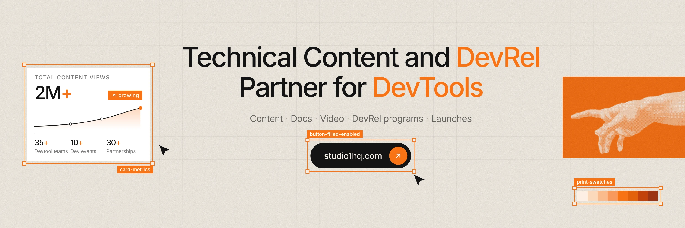
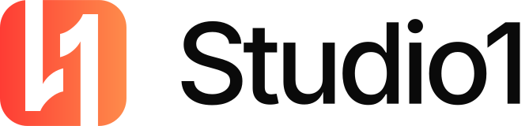

# Studio1 Style Guide

How Studio1 looks, sounds and moves. Use it for anything that carries the Studio1 name: social posts, banners, blog covers, slides, videos, event booths, and anything you make with AI tools.

The source of truth is the paper design in this repo: `lib/paper.ts`, `components/paper/` and `app/blog-cover/`. If this guide and the code disagree, the code wins. Tell us so we can fix the guide.

Building a website, product UI or docs page? The brand page at [studio1hq.com/brand](https://www.studio1hq.com/brand) has the same system as code: tokens, CSS, a Tailwind preset, logo SVGs, templates and `DESIGN.md`, the rules file AI coding tools follow. It's in the "Full brand kit" download, and in this repo under `public/brand/design-system/`.



---

## The look in one line

**A designer's working sheet:** warm paper, black ink and one print orange, marked up with the tools of a design file (selection frames, layer names, cursors), plus dithered block-print images.

### Five rules

1. **Paper first.** Most of every canvas is empty cream paper.
2. **One accent.** Print orange is the only colour besides ink. Use it on one or two things per piece.
3. **One typeface, two weights.** Studio1 Sans Regular and Medium. No bold, no italics, no second font.
4. **Print, don't render.** Use flat colour, grain, dither and halftone. No glossy 3D, glass or glow.
5. **Show the work.** Use selection frames, cursors, layer labels and real product UI. The piece should look like a working design file.

---

## Logo

<p></p>

**This is the main logo: the gradient mark with the wordmark.** Use it by default everywhere: the site, docs, slides, partner pages and anything on a light background. The mark is a rounded square with an **S** and a **1** cut out of it. The master shape is `components/ui/svgs/logo.tsx` (160 × 160 viewBox). Always place a file. Never redraw it.

### Versions

| Version | Use it on | Files |
| :--- | :--- | :--- |
| **Main logo:** gradient mark (`#FE3C34` → `#FE8B4B`) with the black wordmark | The default. Paper and white backgrounds: site, docs, slides, templates | `studio1-logo-on-light.svg`, the mark alone in `components/ui/svgs/logo.tsx` |
| **Dark-mode logo:** the same gradient mark with white cut-outs, white wordmark | Dark backgrounds only (Night bands, dark slides, dark video frames) | `studio1-logo-on-dark.svg`, the mark alone in `public/brand/design-system/logo/studio1-mark-dark.svg` |
| Orange-tile mark on its own | Profile pictures (X, LinkedIn), stickers, app icons | `studio1-mark-orange-tile.png`, `-400.png`, `.svg` |
| Gradient mark on a paper tile | An alternative profile picture on light platforms | `studio1-mark-on-paper.png` |
| One colour, black or white | One-colour print, embroidery, watermarks | `studio1-mark-black.svg`, `studio1-mark-white.svg` in `public/brand/design-system/logo/` |

<p></p>

### Wordmark lockup

The mark, then **Studio1** in Studio1 Sans Medium, both vertically centred. Navbar proportions: **mark 32px, gap 8px, name 24px.** Scale all three together, or use the lockup files above.

The name is always **Studio1**: one word, capital S, the digit 1. Never "Studio 1", "studio1" or "STUDIO1". Handle: **@Studio1HQ**. Site: **studio1hq.com**.

### Space and size

- **Clear space:** leave at least a quarter of the mark's width empty on every side.
- **Minimum size:** 16px on screen, 8mm in print.
- **Circle crops** (X, YouTube, Discord): keep the mark at about 52% of the tile width, as in `studio1-mark-orange-tile.png`. It then stays inside the circle.

### Don't

- Redraw, trace, or AI-generate the mark.
- Put the gradient mark on orange, or the orange tile on an orange background.
- Recolour it (blue, purple, white gradients), outline it, or add a shadow, glow or bevel.
- Rotate, stretch, or tilt it, or put it in a bordered circle.
- Set "Studio1" in another font, or in bold.
- Swap the main logo for the dark-mode or orange-tile versions on light backgrounds.
- Use the old glossy 3D orange tile (the current `app/opengraph-image.png`). It's retired.

---

## Colour

### Core palette

| Name | Hex | Role |
| :--- | :--- | :--- |
| **Paper** | `#F4EFE7` | Background of almost everything. Also the light text and mark colour on orange and Night. |
| **Ink** | `#141414` | Type, icons, lines, primary buttons. |
| **Print orange** | `#F97316` | The one accent: headline keywords, block prints, selection frames, badges, the "+" in stats. |
| **Night** | `#0D0D0D` | Dark bands between paper sections, dark video frames. |
| **White** | `#FFFFFF` | Cards and UI panels sitting on paper. |

**Proportion:** about 80% paper, 15% ink, 5% orange. If the orange starts to feel like a background colour, there's too much of it. Block prints are the exception.

### Ink tints

Use ink at reduced opacity on paper. Don't introduce new greys.

| Ink at | Use for |
| :--- | :--- |
| 100% | Headlines, body text, icons |
| 70% | Secondary text, descriptions |
| 60% | Captions and small labels. The lightest tint for anything people need to read. |
| 32% | Faint marks, separators between words (`Content · Docs · Video`) |
| 14% | Hairlines and dividers |
| 5% | Background grid |

### Print ramp

Tints and shades of print orange for charts, shading inside illustrations, and the swatch strip. Don't use them as new accent colours.

50 `#FDF0E4` · 200 `#FBD9BD` · 300 `#F9BB8C` · 400 `#F89A5C` · **500 `#F97316`** · 600 `#E2620D` · 700 `#C2410C` · 800 `#9A3412`

Print 700 (`#C2410C`) is the one orange dark enough for small text on paper (4.5:1). Use it for link hovers and small orange labels.

### Gradients

Only two gradients exist. Use nothing else.

- **The mark gradient**, `#FE3C34` → `#FE8B4B`, left to right. Only inside the mark.
- **The print panel** (blog covers). Base `#FB8A1E`, a `#FF3A00` glow from both top corners, fading down through `#F7A54A` and `#EEB795` to `#F2B38A`, with a soft cream horizon arc rising from the bottom. See `app/blog-cover/cover.tsx`.

### Contrast

| Pair | Ratio | Rule |
| :--- | :--- | :--- |
| Ink on paper | 16:1 | Any text |
| Ink 70% on paper | 6.4:1 | Any text |
| Ink 60% on paper | 4.6:1 | The floor for small text |
| Ink on print orange | 6.6:1 | Use this for readable text on orange |
| Print 700 on paper | 4.5:1 | Small orange text, link hovers |
| Print orange on Night | 6.9:1 | Fine for text |
| Print orange on paper | 2.5:1 | **Display type (40px+) and shapes only.** Never body text, links or captions. |
| Paper or white on print orange | 2.5–2.8:1 | Only for the logo, frame labels and big display type |

---

## Typography

**Studio1 Sans** is a renamed version of [Inter](https://github.com/rsms/inter), with the same glyphs, spacing and kerning. It's licensed under the SIL Open Font License 1.1 (`app/fonts/LICENSE.txt`), so it's free to install and share.

- **Files:** `app/fonts/` in the repo (`fonts/` in the brand zip). Use `.woff2` on the web and install the `.ttf` files for Figma, Keynote, Canva, Premiere, After Effects and similar apps.
- **Can't install fonts?** Use **Inter** from Google Fonts. The shapes are identical.
- **Two weights only.** Regular (400) for text, Medium (500) for headings, labels, buttons and numbers.
- **Never** use Bold, SemiBold, Light, italics, faux bold, or a second typeface. The old serif-italic accent ("*DevRel*" in a serif) is retired.

### Type scale

| Role | Size | Weight | Line height | Letter spacing |
| :--- | :--- | :--- | :--- | :--- |
| Display (hero headline) | 38px mobile → 68px desktop | Medium | 1.12 | −0.045em |
| Section heading | 32 → 40 → 46px | Medium | 1.2 | −0.045em |
| Card title | 16–20px | Medium | 1.25 | −0.025em |
| Body | 16–18px | Regular | 1.6 | −0.03em |
| Button | 16px | Medium | 1 | −0.02em |
| Eyebrow | 11–12px, UPPERCASE | Medium | 1.2 | +0.1em, ink 60% |
| Frame label | 11px | Medium, white on orange | 1 | −0.01em |
| Big number | 28–40px | Medium | 1 | −0.045em, "+" in orange |

### Type rules

- Headlines get tight negative tracking. Body text is tracked slightly tight too (−0.03em).
- **Accent words:** colour one or two key words of a headline in print orange, the words the piece is about: "Technical Content and **DevRel** Partner for **DevTools**". Never a whole line.
- Stats are written `35+`, `2M+`, `10+`, with the "+" in orange.
- Uppercase is only for small eyebrows and captions. Never set headlines in all caps.
- Headlines and buttons use Title Case, as on the site. Body copy and captions use sentence case.

---

## Graphic elements

These are what make a piece look like Studio1. Use two or three per piece, not all of them.

| Element | How it's drawn |
| :--- | :--- |
| **Paper grain** | Fine fractal noise multiplied over paper at 30% opacity (40% over orange blocks). The SVG is `GRAIN` in `lib/paper.ts`. |
| **Grid** | Faint 50px grid in ink at 5%, fading out toward the edges. |
| **Selection frame** | A 1.5px print-orange line with 6px padding around the content and 9 × 9px square handles (paper fill) on the four corners. The layer label is 11px Medium, white on orange, top-left or bottom-right. |
| **Layer names** | kebab-case, like real Figma layers: `card-metrics`, `button-filled-enabled`, `studio1-mark`, `print-swatches`. Blog covers use ink frames with `.fig` names (`content.fig`, `pricing.fig`). |
| **Cursor** | A solid ink arrow (SVG path `M3.5 2.5 21 10.2l-7.6 2.3-3.3 7.8z` on a 24px grid), just outside a frame corner, as if someone is about to click. One or two per canvas. |
| **Block print** | A flat orange rectangle with grain, holding a cream dithered image or the cream mark. It often bleeds off the edge of the canvas. |
| **The reaching hands** | Dithered hands after Michelangelo's *Creation of Adam*: `public/assets/hand-right.png` and `hand-left.png`. White on transparent. Tint them cream inside an orange block. |
| **White card** | Square corners and a 1px soft bottom shadow (`0 1px 0 rgba(27,23,20,0.06)`). Inside: eyebrow, big number, sparkline with an orange end dot, a row of three stats. |
| **Primary button** | An ink pill, fully rounded, 56px tall, with Medium label in paper and an orange circle holding the arrow or icon. |
| **Secondary button** | An outline pill with a 1.5px ink border and ink label. |
| **Swatch strip** | The eight-step print ramp as a row of squares, in a selection frame. |
| **Construction drawing** | Thin ink lines, dotted arcs and small arrowheads, like geometry notes in a margin. |
| **Night band** | A full-width `#0D0D0D` section between paper sections. Type in paper, accents in orange. |

**Corners:** selection frames, block prints, images, stat cards, tags and labels are square. Content tiles, inputs and code blocks use 6px. Buttons, avatars and status dots are fully round. No other radii, and no big rounded "app cards".

---

## Imagery

- **Dither photos.** People, hands and objects become 1-bit or halftone dot images: cream on orange, or ink on paper. Team portraits are in `public/assets/dither/`.
- **Real people only.** Dither real photos of the actual team, speakers or customers. Never generate fake people to stand in for the team or clients.
- **Real product UI.** Use crisp screenshots of the actual product, placed on paper inside a white card or a selection frame. Don't invent dashboards or numbers.
- **Illustrations are built from UI pieces:** cards, bars, terminals, checklists, charts. They're drawn in ink, white and orange, like the blog covers.
- **Avoid:** stock photos (handshakes, laptops, people pointing at screens), glossy 3D, glassmorphism, neon, purple or blue gradients, lens flares, robot, brain or circuit-board clichés for AI topics, emoji, clip art.

## Icons

- [Phosphor Icons](https://phosphoricons.com) (`@phosphor-icons/react`), the set the site uses.
- **Bold** weight for small UI icons and arrows. **Regular** weight for larger icons inside a 44px ink square tile (paper-coloured icon).
- Use ↗ (arrow up-right) for links and "see more".
- One icon set per piece. No emoji as icons.

---

## Motion

- **Easing:** `cubic-bezier(0.16, 1, 0.3, 1)` for everything (`EASE` in `components/home/ui.tsx`). Fast out, long soft settle.
- **Durations:** 0.25–0.5s for hovers and small changes, 0.9s for section entrances, 1.2s for headline reveals.
- **Headline reveal:** each line rises from behind a mask, 0.12s after the one before.
- **Allowed moves:** rise and fade in over a short distance, frames drawing on, a cursor gliding to a target and clicking, a block print sliding in from the edge it bleeds off.
- **Never:** bounce, elastic, spins, 3D flips, zoom blur, glitch, or lens flares.
- **Reduced motion:** everything must be readable with animation off. The site respects `prefers-reduced-motion`, and videos should never hide information behind an effect.

## Video

| Format | Size |
| :--- | :--- |
| YouTube, demos, talks | 1920 × 1080 (16:9) |
| Shorts, Reels, TikTok | 1080 × 1920 (9:16) |
| LinkedIn and X feed | 1080 × 1350 (4:5) or 1080 × 1080 |

- **Opening:** paper with the headline or the mark. Say what the video is about in the first two seconds.
- **Screen recordings:** show the real product in a clean browser (no bookmarks bar, notifications off). Zoom in on the part that matters and hold for a beat.
- **Captions:** Studio1 Sans Medium, sentence case, at most two lines, ink on a paper box (or paper on a Night box).
- **Lower thirds:** name in Medium, role in ink 60%, inside a selection frame whose label is the person's handle.
- **Transitions:** straight cuts. Between sections, an orange block wipe or a frame drawing on.
- **End card:** on paper, the mark, studio1hq.com and one call to action ("Book a Strategy Call").
- **Thumbnails** (1280 × 720): paper or an orange block, three to six words in Medium, one accent word in orange, a real face (dithered or a photo) or real UI. No red arrows or shocked faces.

---

## Formats and safe zones

| Where | Size | Keep clear |
| :--- | :--- | :--- |
| X profile picture | 400 × 400 (upload `studio1-mark-orange-tile.png`) | Cropped to a circle |
| X header | 1500 × 500 (`x-header.png`) | Bottom-left ~400 × 170px, where the profile picture sits |
| LinkedIn page logo | 400 × 400 (`studio1-mark-orange-tile.png`) | n/a |
| LinkedIn cover | 1128 × 191 (`linkedin-cover-2x.png`) | Left ~200px of the bottom half, where the page logo sits. Mobile crops the sides, so keep text centred. |
| Link preview / OG image | 1200 × 630 | Keep text inside the centre 1000 × 500 |
| Blog cover | 1600 × 900 | Made automatically by `app/blog-cover`. No title on the image, because the page shows it. |
| Social post | 1080 × 1350 (4:5) or 1200 × 675 (16:9) | 60px margin on all sides |
| Slides | 1920 × 1080 | 80px margin |

**Blog cover recipe**, for posts made outside the site: the print panel gradient full-bleed, a white UI card that shows the topic (a comparison, benchmark bars, a checklist, a terminal), inside an ink selection frame labelled `<topic>.fig`, with an ink cursor at its bottom-right corner. No title text.

---

## Writing voice

We write like engineers explaining something to other engineers: plain, specific and short.

Real lines from the site:

> Technical Content and DevRel Partner for DevTools

> We help SaaS and devtool teams publish content, docs, and DevRel programs that build search visibility and trust.

> Ready to Scale Developer Adoption?

- **Numbers and names over adjectives.** "300+ deliverables, 29 framework integrations" beats "massive impact".
- **"We"** is Studio1. **"You"** is the reader.
- **Short sentences.** One idea each.
- **No hype:** avoid revolutionary, game-changing, unlock, supercharge, leverage, cutting-edge, seamless.
- **No emoji, and no exclamation marks** in brand graphics.
- **Terms:** Studio1, DevRel, DX, GitHub, devtool / devtools (lowercase in sentences, "DevTools" only as a headline accent), open source (noun) / open-source (adjective).

---

## Making things with AI

### Rules

1. **AI makes the picture. People place the logo and the words.** Image and video models misspell text and warp logos. Generate without text, then add type and the mark from the brand files in Figma, Canva or your editor.
2. **No generated real people, and no client logos.** Dither real photos instead.
3. **Pull colours back to the palette afterwards.** Models drift toward red or yellow oranges and grey paper. Fix them to `#F97316` and `#F4EFE7`.
4. **Run the checklist at the end of this guide** before anything goes out.

### Style block

Paste this at the end of any image prompt (Midjourney, GPT Image, Gemini, Flux, Firefly):

```text
Studio1 house style: a flat printed graphic on warm off-white paper (#F4EFE7) with a subtle paper grain. Only two colours besides the paper: black ink (#141414) and one vivid print orange (#F97316). Risograph and screen-print feel; coarse halftone and 1-bit pixel dither for any shading or photographic subject. Editorial and minimal, with lots of empty paper, generous margins and square corners. Optional design-tool details: a thin orange selection frame with small square corner handles, a small orange layer-name tag, a solid black arrow cursor. No text.
```

### Negative prompt

```text
purple, blue, teal, neon, rainbow, gradient background, glossy 3D, glassmorphism, chrome, lens flare, bokeh, glow, heavy drop shadows, stock photo, business people, handshake, robot, brain, circuit board, emoji, clip art, text, letters, words, logo, watermark, rounded bubbly shapes, dark moody lighting
```

### Prompt templates

Fill in the `[brackets]`, then add the style block.

**Block-print illustration**

```text
A [subject, e.g. a hand holding a terminal window] rendered as a coarse 1-bit dithered print in cream (#F4EFE7) on a flat print-orange (#F97316) rectangle. The rectangle bleeds off the [right] edge of a warm paper background. The dither dots are visible, like a riso print. Lots of empty paper on the [left] for a headline added later.
```

**Dithered portrait** (start from a real photo, image-to-image)

```text
Turn this photo into a monochrome 1-bit ordered-dither portrait. Cream dots on a flat print-orange background (or black ink dots on warm off-white paper). Keep the face recognisable; plain background; shoulders up; centred.
```

**Social post or hero background**

```text
A top-down view of a designer's working sheet on warm off-white paper with a faint grid. A white UI card showing [a rising line chart / a checklist / a code snippet] sits inside a thin orange selection frame with square corner handles and a small orange tag. A black arrow cursor points at the frame. An orange block print sits at the [right] edge. Leave the [top-centre] empty for a headline.
```

**Product scene**

```text
A clean product screenshot of [product] floating on warm off-white paper inside a thin orange selection frame with square corner handles, and a black arrow cursor near the bottom-right corner. Flat light, no perspective tilt, no device mockup, no shadows except a hairline.
```

**Video** (Veo, Sora, Runway, Kling)

```text
A 6-second shot on warm off-white paper with subtle grain, filmed straight down with a locked camera. A thin orange selection frame draws itself around [a white UI card / an empty area], then a black arrow cursor glides in and clicks. An orange block with a dithered cream [hand / object] slides in from the right edge. Smooth ease-out motion, no camera shake, no lens flare, no 3D, no text.
```

### Prompt for Claude or ChatGPT

Paste this before asking an AI assistant to build an HTML or SVG graphic, a slide, a social post or a landing section:

```text
You are designing for Studio1, a DevRel and technical content agency for devtool teams. Follow the Studio1 paper style exactly:
- Colours: paper #F4EFE7 background, ink #141414 for text, print orange #F97316 as the only accent, white #FFFFFF for cards, Night #0D0D0D for dark bands. Muted text is ink at 60–70% opacity, hairlines ink at 14%. Never put orange text below 40px on paper.
- Type: "Studio1 Sans", Inter, Arial, sans-serif. Only weights 400 and 500. Headlines 500, letter-spacing -0.045em, line-height 1.1. Body 400, 16–18px, line-height 1.6, letter-spacing -0.03em. Eyebrows 11–12px, 500, uppercase, letter-spacing 0.1em. Colour one or two headline keywords orange.
- Details: a fine paper grain; selection frames (1.5px orange border, 9px square corner handles, an 11px white-on-orange layer label in kebab-case); a solid ink arrow cursor near a frame corner; orange block prints holding cream dithered images; white cards with square corners and a 1px soft bottom shadow; ink pill buttons with an orange circle for the icon.
- Shape: square corners for frames, stat cards, images and tags; 6px for content tiles, inputs and code blocks; fully round pill buttons. No gradients, glass, glow, emoji or stock imagery.
- Small orange text uses #C2410C, never #F97316. Links are ink with a 1px underline. Focus rings are 2px solid ink.
- Motion: cubic-bezier(0.16, 1, 0.3, 1); 0.25–0.5s for small moves, 0.9–1.2s for entrances; rise and fade only.
- Copy: plain, specific, short sentences, numbers over adjectives, no hype words, no exclamation marks. The name is always "Studio1".
Use the real logo file. Don't draw the logo yourself.
```

**For copy only:**

```text
Write in Studio1's voice: an engineer explaining to engineers. Plain, specific and short. Use real numbers and names instead of adjectives. "We" is Studio1, "you" is the reader. No hype words (revolutionary, game-changing, unlock, supercharge, leverage, seamless), no emoji, no exclamation marks. Title Case for headlines and buttons, sentence case for everything else.
```

---

## Checklist before you publish

- [ ] Mostly paper. Orange on one or two things only.
- [ ] Only Studio1 Sans (or Inter), Regular and Medium.
- [ ] The logo is the real file, with clear space, and isn't orange on orange.
- [ ] No orange body text; muted text is at least ink 60%.
- [ ] No AI-garbled text, no invented people, no fake UI or numbers.
- [ ] Square corners, except 6px tiles and pill buttons.
- [ ] Right size, nothing important in the safe zones.
- [ ] It's spelled **Studio1**.
